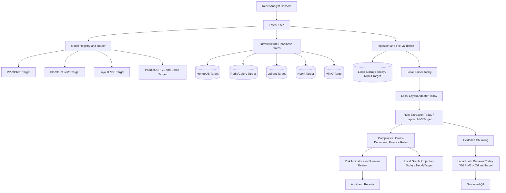

# DOCUMIND VISION AI Migration Plan

## 1. Concise Repository Assessment

The current repository is a runnable DocuMind AI MVP with a FastAPI backend, React/Vite frontend, local document ingestion, deterministic classification and extraction, evidence chunking, local retrieval, grounded QA, finance workflow, audit trail, reports, and graph projection.

The current runtime does not actively run PaddleOCR, LayoutLMv3, Donut, YOLO, Qwen, Qdrant, MongoDB, MinIO, Redis/Celery, or Neo4j persistence by default. Those systems are target production adapters. The local MVP keeps the app runnable on a CPU/Mac profile through parser-based text extraction, `local-layout-adapter-v1`, keyword classification, regex/rule extraction, local hashed embeddings, and in-memory repositories.

This update adds an explicit model registry, selective-routing metadata, and optional infrastructure readiness gates so the product can name the target Vision AI stack and target storage/search/graph services without making false runtime claims.

## 2. Final Architecture



Core principles preserved:

- Visual and extracted evidence must retain document ID, page, source text, confidence, model identity, and review status.
- The system must never automatically declare fraud. It reports suspicious indicators and requires authorised human review.
- Heavy models are active only after configuration, importable packages, and a wired adapter implementation are all present.
- Low-confidence or complex pages request fallback parsing, but unavailable or adapter-pending models are reported explicitly rather than faked.

## 3. Implementation Plan

Phase 1, completed in this update:

- Add `MODEL_PROFILE` and feature flags for PaddleOCR, PaddleOCR structure, PaddleOCR-VL, LayoutLMv3, Donut, YOLO26, BGE-M3, Qdrant, and Qwen.
- Add `ModelRegistryService` to report active, disabled, degraded, and unavailable backends.
- Add selective routing preview with low-confidence, reading-order, complex-table, chart, mixed-language, conflict, and manual-advanced triggers.
- Attach `model_routing` metadata to each processed document.
- Expose the authenticated registry at `GET /api/v1/admin/models` and optional legacy routing preview at `/api/v1/demo-legacy/models/*` when `ENABLE_DEMO_API=true`.
- Surface the model registry on the Admin page.
- Add regression tests for registry truthfulness and routing metadata.

Phase 2, completed in this update:

- Add a DOCUMIND VISION AI backend namespace with upload, analyze, status, document, page, field, table, risk, related-document, review, ask, graph, analytics, model-comparison, report, and active-learning endpoints.
- Add local quality assessment, deterministic word-level OCR boxes, layout regions, table parsing, visual cue detection, schema-specific field extraction, field evidence, confidence routing, duplicate detection, validation rules, graph projection, review tasks, audit events, and JSON/PDF report generation.
- Add explicit adapter contracts and feature-gated implementations for PP-OCRv5, PP-StructureV3, LayoutLMv3, Donut, YOLO, vector search, graph storage, and generator backends. Disabled or unavailable adapters raise instead of returning fake outputs.
- Add local repository and worker contracts, `Idempotency-Key` request handling, and a retry endpoint for Vision jobs.
- Add disk-backed local Vision state under `var/vision_state` so separate API and worker processes can share queued jobs before MongoDB becomes the default runtime.
- Add Celery/Redis worker entrypoints, dispatcher fallback logic, and a Docker Compose `worker` service.
- Add labelled evaluation metrics for classification, field extraction, QA, OCR CER/WER helpers, and a no-fake-metrics response when labels are absent.
- Add a React Vision AI workspace for analysis, upload, document selection, evidence inspection, routed-model status, risk review, evidence-grounded Q&A, report export, and interactive source-region overlays with zoom, rotation, and layer toggles.
- Add Docker Compose services for MongoDB, Redis, Qdrant, and MinIO as development targets while preserving the local in-memory runtime.
- Add optional MongoDB, Redis, MinIO, Qdrant, and Neo4j connector/readiness classes plus `GET /api/v1/vision/infrastructure/readiness`.
- Add spec-compatible top-level Vision aliases for documents, reviews, ask/questions, graph, analytics, and admin model/rule/audit inspection.
- Add `scripts/seed_vision_demo.py` for a reproducible Vision AI demo.

Remaining production hardening gates:

- Enable and smoke-test the implemented PP-OCRv5, PP-StructureV3, PaddleOCR-VL, LayoutLMv3, Donut, YOLO26, Qwen, and BGE adapters against real package/model installations.
- Provide fine-tuned checkpoints for LayoutLMv3, Donut, YOLO26, DINOv2, DeBERTa/CUAD, SegFormer forensics, and supervised risk scoring where those models are part of the deployment profile.
- Add tenant-specific runtime selection, database migrations, bucket/collection/index initialisation scripts, and deployment smoke tests for MongoDB/Qdrant/Neo4j/MinIO/Redis.
- Add Redis progress-event fanout, dead-letter queues, and worker autoscaling policy for long-running model adapters.
- Add labelled evaluation scripts before reporting model metrics.

## 4. Commands

Local backend:

```bash
cd backend
python -m pytest
uvicorn app.main:app --reload --port 8000
```

Frontend:

```bash
cd frontend
npm run build
npm run dev
```

Celery worker profile:

```bash
cd backend
ENABLE_REDIS=true celery -A app.workers.vision_tasks:celery_app worker \
  --loglevel=INFO -Q vision-processing --pool=solo
```

Inspect model registry:

```bash
curl http://localhost:8000/api/v1/demo-legacy/models/registry
```

Inspect Vision infrastructure readiness:

```bash
curl http://localhost:8000/api/v1/vision/infrastructure/readiness
```

Preview fallback routing:

```bash
curl -X POST http://localhost:8000/api/v1/demo-legacy/models/routing-preview \
  -H "Content-Type: application/json" \
  -d '{"ocr_mean_confidence":0.42,"reading_order_confidence":0.55,"has_complex_table":true}'
```

Seed demo:

```bash
python scripts/seed_vision_demo.py
```
