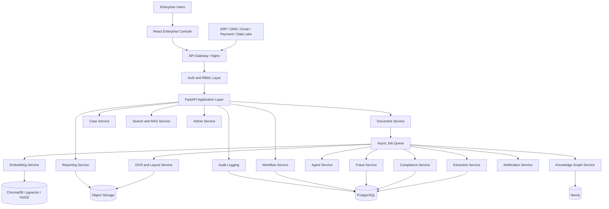
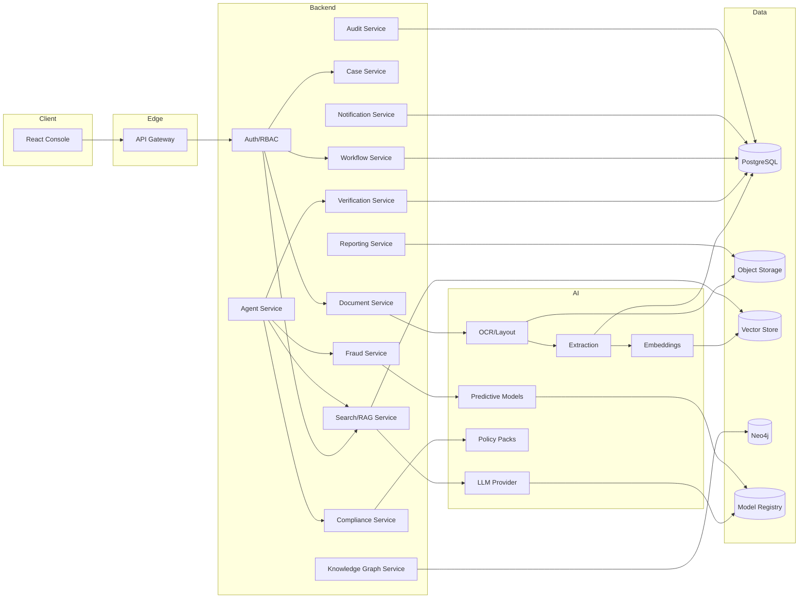
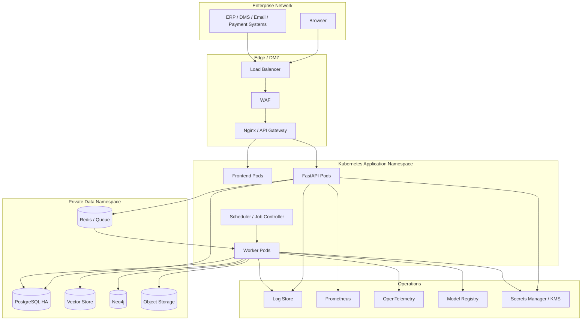
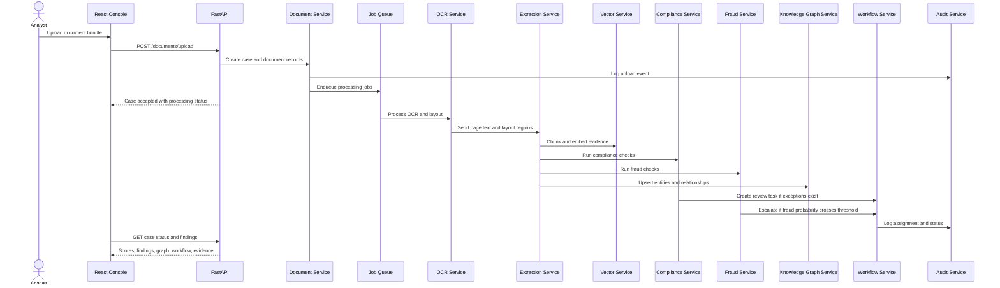
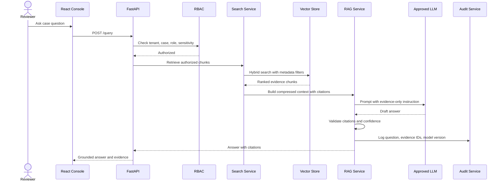
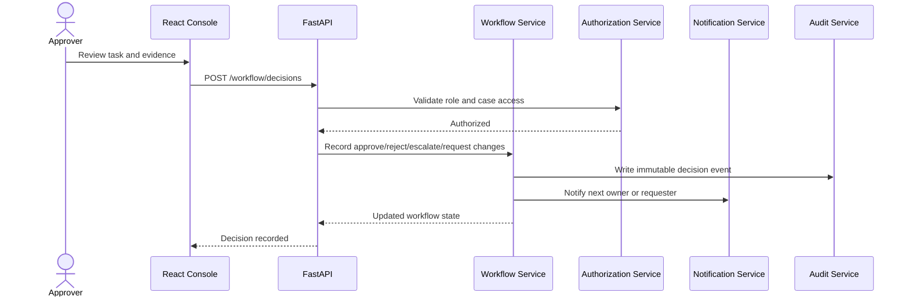
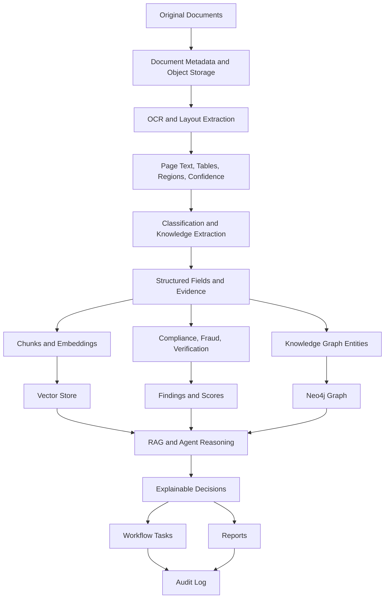
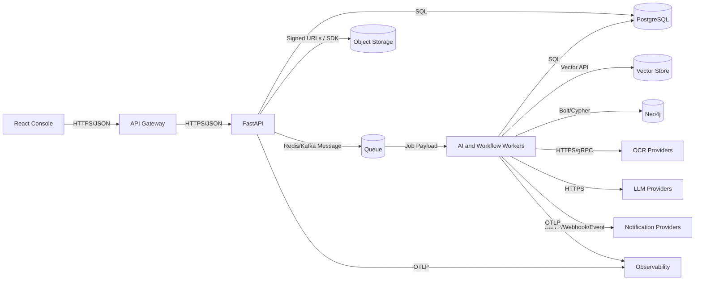
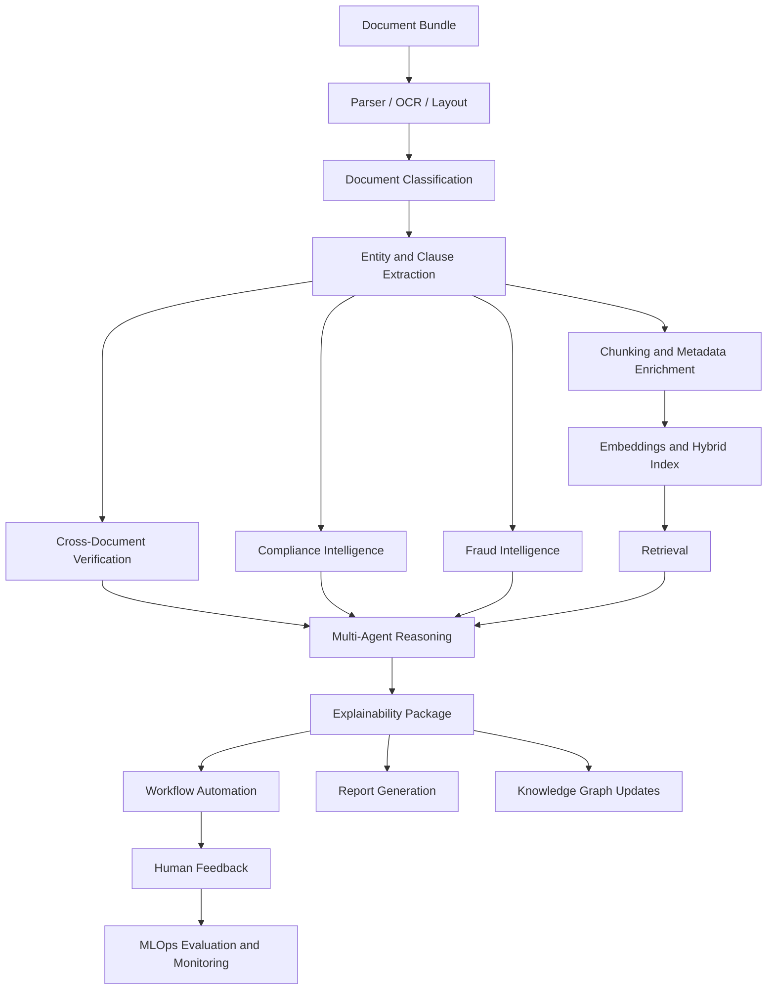

# Phase 2 - System Architecture

## Status

Phase 2 is complete and serves as the architecture baseline for Phase 3. Phase 4, Knowledge Graph Design, should not begin until Phase 3 is approved or revised.

## 1. Objectives

- Convert the approved Phase 1 SRS into a scalable enterprise system architecture.
- Define high-level and low-level architecture for DocuMind AI 2.0.
- Establish service boundaries for document intelligence, compliance, fraud, graph reasoning, workflow, reporting, and notifications.
- Define communication patterns across frontend, API gateway, backend services, AI pipelines, data stores, and enterprise integrations.
- Provide diagrams that guide later database, backend, frontend, AI, DevOps, security, testing, and MLOps phases.

## 2. Architecture Principles

- Enterprise-first: secure, auditable, multi-tenant, observable, scalable, and configurable.
- Evidence-first AI: every generated answer, risk signal, compliance finding, and agent decision must link to source evidence.
- Modular services: each major business capability has a clear service boundary and can evolve independently.
- Replaceable AI adapters: OCR, embeddings, LLMs, vector stores, graph stores, and agent frameworks must be configurable.
- Human-in-the-loop: high-impact legal, financial, compliance, and fraud outcomes require workflow review.
- Phase-safe implementation: architecture supports the current runnable scaffold and later production hardening.

## 3. Functional Requirements Covered In This Phase

| ID | Requirement |
| --- | --- |
| FR-ARCH-001 | Define frontend, API gateway, backend service, AI pipeline, data store, and integration layers. |
| FR-ARCH-002 | Define service boundaries for Document, OCR, Extraction, RAG, Agent, Compliance, Fraud, Knowledge Graph, Workflow, Reporting, Notification, Audit, and Admin services. |
| FR-ARCH-003 | Define synchronous API communication and asynchronous processing communication. |
| FR-ARCH-004 | Define how documents flow from upload through OCR, extraction, retrieval, reasoning, reporting, and approval. |
| FR-ARCH-005 | Define security checkpoints across authentication, authorization, tenant isolation, audit logging, and evidence access. |
| FR-ARCH-006 | Define architecture views that can drive Phase 3 database design and later implementation phases. |

## 4. Non-Functional Requirements

| ID | Requirement |
| --- | --- |
| NFR-ARCH-001 | Architecture shall support horizontal scaling of frontend, API, workers, retrieval, and workflow services. |
| NFR-ARCH-002 | Architecture shall support asynchronous processing for OCR, embeddings, agents, reports, and graph updates. |
| NFR-ARCH-003 | Architecture shall support tenant isolation across all services and data stores. |
| NFR-ARCH-004 | Architecture shall support structured observability with logs, metrics, traces, and audit events. |
| NFR-ARCH-005 | Architecture shall support deployment through Docker Compose locally and Kubernetes in production. |
| NFR-ARCH-006 | Architecture shall support regulated environments with private cloud, VPC-only, or on-premises deployments. |
| NFR-ARCH-007 | Architecture shall support fail-safe behavior when optional AI providers are unavailable. |

## 5. Research Contribution

The architecture enables research contributions in:

- Multi-document intelligence through case-level retrieval, verification, and relationship graphs.
- Multi-agent enterprise reasoning through orchestrated specialist agents.
- Explainable AI through evidence objects that flow across all services.
- Cross-document verification through structured extraction, graph relationships, and rules/model checks.
- Fraud network detection through graph traversal, vendor linking, and predictive scoring.
- Compliance intelligence through policy packs, clause detection, control mapping, and audit evidence.

## 6. High-Level Design



## 7. Low-Level Design

### 7.1 Frontend Layer

- React enterprise console.
- TypeScript target for later frontend phase.
- MUI component system with project-specific custom CSS.
- React Query target for API caching and workflow invalidation.
- Recharts analytics.
- Pages: Dashboard, Documents, Search, Risk, Compliance, Fraud, Graph, Workflow, Audit, Admin, Reports, Agent Center, Evidence Explorer.

### 7.2 Gateway and API Layer

- Nginx or cloud API gateway routes `/api/*` to FastAPI.
- Gateway owns TLS termination, request size limits, rate limits, and optional WAF integration.
- FastAPI provides versioned APIs under `/api/v1`.
- Authentication middleware validates JWT/OIDC tokens.
- Authorization middleware enforces RBAC and tenant scope.
- Request context includes tenant ID, user ID, role set, correlation ID, and trace ID.

### 7.3 Core Backend Services

| Service | Responsibility |
| --- | --- |
| Auth Service | Authentication integration, JWT validation, user context, service tokens. |
| Authorization Service | RBAC and future ABAC checks for APIs, evidence, reports, and workflow actions. |
| Document Service | Upload, checksum, versioning, metadata, storage URI, processing state. |
| Case Service | Case creation, case status, document bundle ownership, case timeline. |
| OCR Service | Text extraction, layout extraction, tables, signatures, stamps, checkboxes, bounding regions. |
| Extraction Service | Entity, field, clause, amount, date, vendor, bank, risk, and policy extraction. |
| Chunking Service | Page-aware chunking, metadata enrichment, sensitivity labels. |
| Embedding Service | Embedding generation and vector index writes. |
| Search Service | Hybrid retrieval, metadata filtering, reranking, source citation retrieval. |
| RAG Service | Citation-grounded answer generation and context compression. |
| Agent Service | LangGraph-ready orchestration for specialist enterprise agents. |
| Compliance Service | Clause checks, policy checks, control mapping, compliance scoring. |
| Fraud Service | Duplicate, mismatch, anomaly, fake-document, vendor-risk, and transaction-risk scoring. |
| Verification Service | Cross-document checks across invoice, PO, contract, vendor, bank account, and policy evidence. |
| Knowledge Graph Service | Entity linking, relationship writes, graph traversal, risk path discovery. |
| Workflow Service | Assignments, approvals, escalations, comments, SLA state. |
| Reporting Service | Executive, compliance, fraud, risk, audit, and evidence reports. |
| Notification Service | Assignment, escalation, SLA, approval, and report notifications. |
| Audit Service | Immutable audit events for all regulated actions and AI decisions. |
| Admin Service | Tenant, user, role, policy pack, model, integration, retention configuration. |

### 7.4 Data Layer

| Store | Purpose |
| --- | --- |
| PostgreSQL | Tenants, users, roles, documents, cases, findings, workflows, approvals, reports, audit logs. |
| Object Storage | Original files, OCR artifacts, thumbnails, generated reports, export files. |
| Vector Store | Document chunks, embeddings, retrieval metadata, citation lookup. |
| Neo4j | Enterprise knowledge graph, relationships, traversal, vendor risk, fraud network discovery. |
| Cache | Session-adjacent lookups, dashboard aggregates, short-lived authorization metadata. |
| Model Registry | Model versions, prompt versions, rule pack versions, evaluation metadata. |

### 7.5 Async Processing Layer

Long-running jobs should run outside request/response paths:

- OCR and layout processing.
- Classification and extraction.
- Chunking and embedding.
- Knowledge graph writes.
- Agent orchestration.
- Report generation.
- Notification dispatch.
- Model monitoring events.

Target production options: Celery/RQ with Redis, Kafka consumers, cloud queues, or Kubernetes Jobs depending on tenant deployment requirements.

## 8. Component Diagram



## 9. Deployment Diagram



## 10. Sequence Diagrams

### 10.1 Multi-Document Upload and Analysis



### 10.2 Citation-Grounded Question Answering



### 10.3 Approval Workflow



## 11. Data Flow Diagram



## 12. Service Communication Diagram



## 13. Service Boundary Details

### 13.1 Document Service

- Owns document metadata, versions, checksums, storage URIs, processing state, and upload policy.
- Does not own extraction, classification, or compliance logic.
- Emits processing events for downstream services.

### 13.2 OCR Service

- Owns OCR provider selection, layout region detection, table extraction, and page-level confidence.
- Produces normalized page artifacts consumed by extraction and evidence services.

### 13.3 Extraction Service

- Owns entity, field, clause, and risk extraction.
- Produces normalized extracted fields and evidence links.
- Feeds vector indexing, graph creation, compliance checks, fraud checks, and reports.

### 13.4 RAG Service

- Owns retrieval orchestration, context construction, citation validation, and answer packaging.
- Must reject or downgrade answers without sufficient evidence.

### 13.5 Agent Service

- Owns multi-agent orchestration.
- Calls retrieval, compliance, fraud, verification, graph, and workflow tools.
- Persists agent decisions with reasoning chains and evidence.

### 13.6 Compliance Service

- Owns policy packs, clause requirements, regulatory mapping, compliance scoring, and compliance findings.
- Integrates with workflow for required review.

### 13.7 Fraud Service

- Owns duplicate invoice checks, amount mismatch checks, payment anomalies, vendor anomalies, fake-document signals, graph fraud signals, and fraud probability.
- Integrates with workflow for holds and escalation.

### 13.8 Knowledge Graph Service

- Owns entity linking, relationship writes, graph APIs, traversal, and graph-derived risk features.
- Does not replace PostgreSQL as the operational source of truth.

### 13.9 Workflow Service

- Owns task assignment, approval state, comments, SLA state, and escalation routing.
- Records every state transition through Audit Service.

### 13.10 Reporting Service

- Owns executive, compliance, fraud, risk, audit, and evidence reports.
- Generates signed export artifacts in production deployments.

### 13.11 Notification Service

- Owns email, webhook, chat, and event notifications.
- Receives workflow and report events.

## 14. Folder Structure

Phase 2 keeps the existing repository layout and introduces phase documentation:

```text
backend/
  app/
    api/
    core/
    models/
    services/
    tests/
frontend/
  src/
    components/
    lib/
docs/
  phases/
    PHASE_01_SRS.md
    PHASE_02_SYSTEM_ARCHITECTURE.md
infra/
  docker/
  k8s/
  nginx/
scripts/
.github/workflows/
```

Future phases may expand this into service-specific backend packages, frontend page folders, shared OpenAPI clients, and worker modules.

## 15. Database Changes

No database schema is changed in Phase 2. Phase 3 shall design the PostgreSQL schema for:

- Users
- Roles
- Permissions
- Documents
- DocumentVersions
- Chunks
- Embeddings
- Cases
- ComplianceFindings
- FraudFindings
- AuditLogs
- Approvals
- Reports
- Notifications

Phase 4 shall design the Neo4j graph schema and graph APIs.

## 16. API Design Requirements

Phase 2 defines these API groups for later detailed design:

| API Group | Purpose |
| --- | --- |
| `/auth` | Login callback, token refresh, service token validation. |
| `/admin` | Tenant, role, permission, user, policy, model, retention configuration. |
| `/documents` | Upload, metadata, versions, status, OCR artifacts. |
| `/cases` | Case bundle, scores, findings, graph summary, timeline. |
| `/search` | Search, filters, chunk retrieval, citation lookup. |
| `/query` | Citation-grounded RAG answers. |
| `/agents` | Agent runs, decisions, reasoning chains, replay. |
| `/compliance` | Findings, controls, policy packs, scores. |
| `/fraud` | Fraud findings, risk signals, fraud score, hold recommendations. |
| `/verification` | Cross-document checks and mismatch findings. |
| `/graph` | Case graph, entity graph, relationship search, risk paths. |
| `/workflow` | Tasks, decisions, assignments, comments, SLA events. |
| `/reports` | Report generation, report status, report export. |
| `/notifications` | Notification preferences, events, delivery status. |
| `/audit` | Audit event search and export. |
| `/metrics` | Dashboard and operational metrics. |

## 17. Backend Implementation Guidance

Phase 2 does not require new executable backend features. Later backend phases should implement this architecture with:

- FastAPI routers per bounded context.
- Typed Pydantic request/response contracts.
- Dependency-injected tenant, auth, audit, and settings context.
- Service-layer classes for business logic.
- Repository/data-access layer for persistent stores.
- Async worker entry points for long-running AI jobs.
- Shared evidence model across extraction, RAG, agents, compliance, fraud, verification, reports, and workflow.
- OpenAPI documentation for every public route.

## 18. Frontend Implementation Guidance

Phase 2 does not require new frontend pages. Later frontend phases should implement:

- Enterprise navigation with role-aware page access.
- Case command center as the default operational screen.
- Evidence Explorer for source snippets and highlighted text.
- Agent Center for agent decisions, reasoning, and replay.
- Admin pages for tenants, users, roles, policy packs, integrations, and model configuration.
- Audit pages for immutable event review and export.
- Analytics pages for risk, compliance, fraud, workflow, document, and agent trends.

## 19. AI Pipeline Architecture



## 20. Security Considerations

- Authenticate every user and API client before accessing documents, cases, evidence, reports, or graph data.
- Authorize every request with tenant scope and RBAC.
- Enforce future ABAC for document sensitivity, region, business unit, legal hold, and data class.
- Prevent cross-tenant retrieval by applying metadata filters before vector search.
- Store original files in encrypted object storage.
- Encrypt database, vector, graph, cache, queue, and backup storage.
- Redact PII in logs, traces, metrics, and model prompts when policy requires it.
- Apply prompt-injection filtering and instruction hierarchy for retrieved content.
- Audit uploads, reads, queries, exports, corrections, approvals, admin actions, and AI decisions.
- Use service identities and least-privilege secrets for workers and integrations.

## 21. Testing Strategy

Architecture-level test planning for later phases:

- Contract tests for service API boundaries.
- Integration tests for upload-to-processing event flow.
- Authorization tests for tenant and role boundaries.
- Retrieval tests for tenant-scoped vector filtering.
- Evidence tests to ensure findings and answers include source references.
- Workflow tests for task state transitions and audit logging.
- Resilience tests for provider timeouts, queue retries, and partial processing failures.
- Load tests for upload bursts, dashboard reads, retrieval queries, and report generation.
- Security tests for malicious documents, prompt injection, file upload abuse, and PII leakage.

## 22. Deployment Strategy

### Local

- Docker Compose for API, frontend, PostgreSQL, vector store, Neo4j, and supporting services.
- Deterministic local AI fallbacks for developer productivity.

### Staging

- Kubernetes namespace with separate app, data, and observability resources.
- Non-production model providers and seeded test data.
- CI/CD deployment after tests and scans.

### Production

- Kubernetes with multiple API and worker replicas.
- Managed PostgreSQL where possible.
- Managed or hardened object storage.
- Tenant-approved vector and graph storage.
- External secrets backed by KMS or Vault.
- WAF, TLS, network policies, resource limits, autoscaling, backup, and disaster recovery.

## 23. Production-Ready Code Expectations

Later code phases shall:

- Keep service boundaries consistent with this architecture.
- Avoid mixing AI provider code directly into API routes.
- Preserve evidence IDs and source references across services.
- Use idempotent job processing for long-running tasks.
- Include correlation IDs in logs and audit events.
- Support retries and dead-letter handling for failed async jobs.
- Validate tenant access before reading SQL, vector, graph, or object storage records.
- Keep report generation reproducible from stored case state and evidence.
- Version policy packs, prompts, model adapters, and extraction schemas.

## 24. Architecture Risks and Mitigations

| Risk | Mitigation |
| --- | --- |
| OCR quality varies across scanned documents | Use confidence thresholds, human correction, provider fallback, and page-level evidence. |
| LLM hallucination in generated answers | Enforce citation-only answers, evidence validation, and answer abstention. |
| Cross-tenant data leakage through retrieval | Apply tenant metadata filters before search and enforce authorization in API and retrieval layers. |
| Long-running processing blocks API | Use async jobs and return case processing status immediately. |
| Graph data diverges from operational state | Treat PostgreSQL as source of truth and graph writes as idempotent projections. |
| Fraud and compliance scores are over-trusted | Require evidence, confidence, human review, and workflow approval for high-impact actions. |
| Provider lock-in | Keep provider adapters behind service interfaces. |

## 25. Acceptance Criteria

Phase 2 is accepted when:

- High-level design is documented.
- Low-level design is documented.
- Component diagram is documented.
- Deployment diagram is documented.
- Sequence diagrams are documented.
- Data flow diagram is documented.
- Service communication diagram is documented.
- Service boundaries are documented.
- Database impact is documented.
- API groups are documented.
- Backend, frontend, AI, security, testing, deployment, and production-code guidance are documented.
- The architecture is stable enough to serve as the baseline for Phase 3 and later implementation packages.

## 26. Phase 2 Exit Checklist

- [x] Objectives defined
- [x] Functional requirements defined
- [x] Non-functional requirements defined
- [x] Research contribution defined
- [x] System design defined
- [x] Folder structure defined
- [x] Database changes documented
- [x] API design documented
- [x] Backend implementation guidance documented
- [x] Frontend implementation guidance documented
- [x] AI pipeline documented
- [x] Security considerations documented
- [x] Testing strategy documented
- [x] Deployment strategy documented
- [x] Production-ready code expectations documented
- [x] High-level design generated
- [x] Low-level design generated
- [x] Component diagram generated
- [x] Deployment diagram generated
- [x] Sequence diagrams generated
- [x] Data flow diagram generated
- [x] Service communication diagram generated

## 27. Next Phase Gate

Phase 3 has been completed from this architecture baseline and produced PostgreSQL database design, ER diagram, SQL schema, and indexing strategy. Phase 4 should wait for Phase 3 approval or revision.
