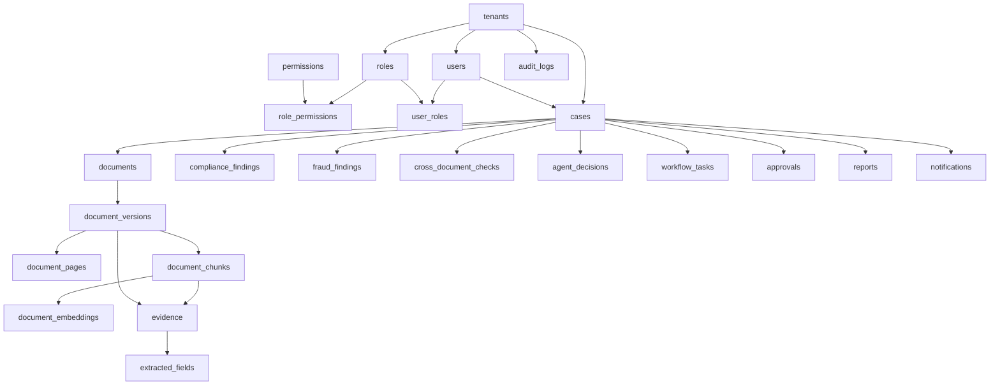

# Phase 3 - Database Design

## Status

Phase 3 is complete when this database design package and the PostgreSQL init schema are reviewed and accepted. Phase 4, Knowledge Graph Design, should not begin until this phase is approved or revised.

## 1. Objectives

- Convert the Phase 1 requirements and Phase 2 architecture into a production-shaped relational data model.
- Define tenant-scoped PostgreSQL tables for identity, documents, versions, chunks, embeddings, cases, findings, approvals, notifications, reports, and audit logs.
- Preserve document lineage from original file through OCR, extraction, retrieval, agent reasoning, workflow, and reporting.
- Support evidence-first explainability with page, chunk, text highlight, confidence, and model metadata.
- Establish indexing, retention, and migration guidance for later backend, frontend, AI, DevOps, security, testing, and MLOps phases.

## 2. Functional Requirements

| ID | Requirement |
| --- | --- |
| FR-DB-001 | Store tenants, users, roles, permissions, role grants, and user-role assignments. |
| FR-DB-002 | Store case records that group related contracts, invoices, purchase orders, statements, emails, policies, and reports. |
| FR-DB-003 | Store document metadata separately from immutable document versions. |
| FR-DB-004 | Store page-level OCR/layout output and chunk-level retrieval metadata. |
| FR-DB-005 | Store embedding metadata in PostgreSQL while allowing ChromaDB, pgvector, or FAISS as the vector execution layer. |
| FR-DB-006 | Store extracted fields, evidence, compliance findings, fraud findings, cross-document checks, and agent decisions. |
| FR-DB-007 | Store approvals, workflow tasks, reports, notifications, and immutable audit logs. |
| FR-DB-008 | Enforce tenant scoping, foreign keys, uniqueness rules, confidence ranges, and score ranges. |
| FR-DB-009 | Provide indexes for tenant isolation, case review, document processing queues, retrieval lookup, dashboards, and audit review. |

## 3. Non-Functional Requirements

| ID | Requirement |
| --- | --- |
| NFR-DB-001 | Database queries shall be tenant scoped by default. |
| NFR-DB-002 | High-volume tables shall include composite indexes that start with `tenant_id`. |
| NFR-DB-003 | JSONB shall be used only for flexible metadata, model details, bounding boxes, and evidence snapshots. |
| NFR-DB-004 | Immutable records such as document versions, evidence, findings, decisions, reports, and audit logs shall not be overwritten in normal workflows. |
| NFR-DB-005 | Large binaries shall remain in object storage, with hashes and object URIs stored in PostgreSQL. |
| NFR-DB-006 | Schema shall run on the default PostgreSQL image used by Docker Compose without requiring non-core extensions. |
| NFR-DB-007 | Design shall allow later migration to Alembic-managed production migrations. |

## 4. Research Contribution

This schema supports publishable research contributions by making intermediate reasoning artifacts persistent and auditable:

- Multi-document intelligence: cases, documents, versions, chunks, extracted fields, and cross-document checks preserve relationships across source files.
- Multi-agent reasoning: agent decisions store specialist outputs, evidence snapshots, confidence, and reasoning chains.
- Explainable AI: evidence records connect decisions to source documents, pages, highlighted text, chunks, bounding boxes, and model versions.
- Compliance intelligence: compliance findings store rule packs, frameworks, controls, score impact, and remediation.
- Fraud intelligence: fraud findings store signal type, probability, amount at risk, evidence, and model version.
- Knowledge graph readiness: stable UUIDs and normalized tenant/case/document/entity references can be projected into Neo4j during Phase 4.

## 5. System Design

PostgreSQL is the operational system of record. Object storage holds original documents and generated exports. Vector stores hold ANN indexes. Neo4j receives graph projections in the next phase.



## 6. Folder Structure

```text
docs/phases/PHASE_03_DATABASE_DESIGN.md   Phase 3 source of truth
docs/DATABASE_DESIGN.md                   Database summary and handoff index
infra/docker/postgres-init.sql            Runnable local PostgreSQL schema
backend/app/models/schemas.py             Current API DTOs that future ORM models should map to
```

Later production phases should add:

```text
backend/app/db/                           SQLAlchemy engine, sessions, repositories
backend/app/models/orm.py                 ORM models or split model modules
backend/alembic/                          Versioned schema migrations
```

## 7. Database Changes

The Docker init schema now defines these table groups:

| Group | Tables |
| --- | --- |
| Identity and Access | `tenants`, `users`, `roles`, `permissions`, `role_permissions`, `user_roles` |
| Case and Document Lineage | `cases`, `documents`, `document_versions`, `document_pages` |
| Retrieval and AI Artifacts | `document_chunks`, `document_embeddings`, `evidence`, `extracted_fields`, `agent_decisions` |
| Risk, Compliance, and Fraud | `compliance_findings`, `fraud_findings`, `cross_document_checks` |
| Workflow and Operations | `workflow_tasks`, `approvals`, `reports`, `notifications` |
| Governance | `audit_logs` |

### 7.1 Core Table Responsibilities

| Table | Responsibility |
| --- | --- |
| `tenants` | Enterprise customer boundary, region, status, retention, and settings. |
| `users` | Tenant-scoped identity provider subjects and profile metadata. |
| `roles` | Tenant-scoped RBAC roles. |
| `permissions` | Stable permission codes such as `documents:read` and `approvals:decide`. |
| `cases` | Multi-document review unit with risk, compliance, fraud, SLA, and ownership fields. |
| `documents` | Logical document record attached to a case. |
| `document_versions` | Immutable file version metadata, checksum, storage URI, and processing status. |
| `document_pages` | Page-level OCR text, layout JSON, confidence, dimensions, and bounding regions. |
| `document_chunks` | Retrieval chunks with page range, metadata, sensitivity, checksum, and token count. |
| `document_embeddings` | Embedding/model metadata plus external vector-store IDs. |
| `evidence` | Source-grounded explainability object used by fields, findings, agents, and reports. |
| `extracted_fields` | Normalized invoice, PO, contract, vendor, amount, date, clause, and risk fields. |
| `compliance_findings` | Clause, policy, regulatory, and framework-control findings. |
| `fraud_findings` | Duplicate invoice, vendor anomaly, payment mismatch, fake-document, and anomaly signals. |
| `cross_document_checks` | Invoice-to-PO, contract-to-invoice, and vendor-to-bank verification results. |
| `agent_decisions` | Specialist agent outputs with reasoning chain and evidence snapshot. |
| `workflow_tasks` | Assignments, state, SLA, and routing metadata. |
| `approvals` | Human approval requests, decisions, comments, and timestamps. |
| `reports` | Generated report metadata, object URI, hash, and status. |
| `notifications` | User notifications for assignments, escalations, SLA risk, approvals, and reports. |
| `audit_logs` | Immutable regulated event trail. |

## 8. SQL Schema

The canonical runnable SQL is maintained in `infra/docker/postgres-init.sql`. It is intentionally compatible with the standard PostgreSQL Docker image. For production pgvector deployments, add the `vector` extension and migrate `document_embeddings.embedding_vector` from `DOUBLE PRECISION[]` or external vector IDs to a `vector(n)` column with an HNSW or IVFFlat index.

Key design choices:

- UUID primary keys use `uuid_generate_v4()`.
- Tenant-owned operational tables include `tenant_id`.
- Large binary files are represented by `object_uri`, `checksum_sha256`, and content metadata.
- Flexible AI payloads use JSONB for `metadata`, `layout_json`, `bounding_boxes`, `evidence_snapshot`, `reasoning_chain`, and `model_metadata`.
- Confidence and probability columns are constrained to `0..1`.
- Scores are constrained to `0..100`.
- Deletions cascade inside a tenant-owned case/document lineage, while audit logs are retained.

## 9. Indexing Strategy

| Access Pattern | Indexes |
| --- | --- |
| Tenant filtering | Composite indexes beginning with `tenant_id` on users, roles, cases, documents, findings, workflow, approvals, reports, notifications, and audit logs. |
| Case review | `idx_cases_tenant_status`, `idx_cases_tenant_priority`, `idx_documents_case`, `idx_findings_case` family. |
| Processing queues | Partial indexes on document version OCR, extraction, and embedding status. |
| Retrieval | `idx_document_chunks_case`, `idx_document_chunks_doc_version`, full-text GIN index on chunk text, and vector-store ID lookup. |
| JSONB metadata search | GIN indexes on document version metadata, chunk metadata, evidence bounding boxes, and audit metadata. |
| Dashboard analytics | Created-at/status/severity/probability indexes on findings, workflow tasks, approvals, reports, and notifications. |
| Security review | `idx_audit_logs_tenant_created`, `idx_audit_logs_resource`, and actor/time indexes. |

## 10. API Design

Phase 3 does not add new HTTP endpoints. It defines persistence contracts that later API phases should map to:

| API Area | Tables |
| --- | --- |
| Auth/RBAC | `users`, `roles`, `permissions`, `user_roles`, `role_permissions` |
| Documents | `cases`, `documents`, `document_versions`, `document_pages` |
| Search/RAG | `document_chunks`, `document_embeddings`, `evidence` |
| Compliance | `compliance_findings`, `evidence`, `audit_logs` |
| Fraud | `fraud_findings`, `cross_document_checks`, `evidence`, `audit_logs` |
| Workflow | `workflow_tasks`, `approvals`, `notifications`, `audit_logs` |
| Reports | `reports`, `evidence`, `agent_decisions` |

## 11. Backend Implementation

Implemented in this phase:

- `infra/docker/postgres-init.sql` now provides the production-shaped local schema.
- Existing backend DTOs remain untouched because the current service layer is deterministic and in-memory.

Planned for Phase 5:

- Add SQLAlchemy models and repositories.
- Add request-scoped tenant context.
- Add transactional service methods for document upload, case creation, findings, approvals, notifications, and audit logs.
- Add Alembic migrations after the schema is accepted.

## 12. Frontend Implementation

Phase 3 does not change React screens. It defines the data backing for later pages:

- Dashboard: `cases`, `compliance_findings`, `fraud_findings`, `workflow_tasks`, `reports`.
- Documents: `documents`, `document_versions`, `document_pages`, `extracted_fields`.
- Search and Evidence Explorer: `document_chunks`, `document_embeddings`, `evidence`.
- Compliance and Fraud: `compliance_findings`, `fraud_findings`, `cross_document_checks`.
- Workflow and Admin: `approvals`, `notifications`, `users`, `roles`, `permissions`.
- Audit: `audit_logs`.

## 13. AI Pipeline

The schema supports the later AI pipeline as follows:

1. Upload creates `cases`, `documents`, and `document_versions`.
2. OCR/layout writes `document_pages`.
3. Chunking writes `document_chunks`.
4. Embedding generation writes `document_embeddings` and external vector IDs.
5. Extraction writes `extracted_fields` with `evidence_id`.
6. Verification writes `cross_document_checks`.
7. Compliance and fraud services write `compliance_findings` and `fraud_findings`.
8. Agents write `agent_decisions` with evidence snapshots and reasoning chains.
9. Workflow writes `workflow_tasks`, `approvals`, `notifications`, and `audit_logs`.
10. Reporting writes `reports` and references evidence snapshots.

## 14. Security Considerations

- Tenant ID is present on every tenant-owned table to support row-level security in production.
- RBAC is modeled through roles, permissions, and join tables.
- Audit logs are append-only by convention and indexed for forensic review.
- PII/PHI/PCI values should be classified with `sensitivity_label` and redacted before broad display.
- Document binaries remain outside PostgreSQL in encrypted object storage.
- Sensitive JSONB metadata should be encrypted or tokenized before storage in regulated deployments.
- Production should enable TLS, disk encryption, managed secrets, backups, PITR, and row-level security policies.

## 15. Testing Strategy

- SQL syntax validation against PostgreSQL 16.
- Migration smoke test through `docker compose up postgres`.
- Backend regression tests to ensure existing deterministic APIs remain unaffected.
- Future repository tests for tenant scoping, RBAC joins, document version immutability, evidence linkage, and audit log creation.
- Future integration tests for upload-to-report persistence flow.

## 16. Deployment Strategy

- Local development uses `infra/docker/postgres-init.sql` through Docker Compose.
- Existing local volumes must be recreated to apply init-schema changes to a fresh database.
- Production should use versioned migrations, managed PostgreSQL, backups, PITR, encryption, and migration gates.
- High-volume tenants should partition audit logs and optionally document chunks by tenant or time.
- pgvector deployments should use a Postgres image or managed service with pgvector enabled.

## 17. Production-Ready Code

Delivered in this phase:

- Phase document: `docs/phases/PHASE_03_DATABASE_DESIGN.md`.
- Runnable schema: `infra/docker/postgres-init.sql`.
- Summary handoff: `docs/DATABASE_DESIGN.md`.
- README status updated to show Phase 3 complete and Phase 4 awaiting approval.

Phase 4 should build the Neo4j graph schema and graph APIs using stable IDs from this relational design.
